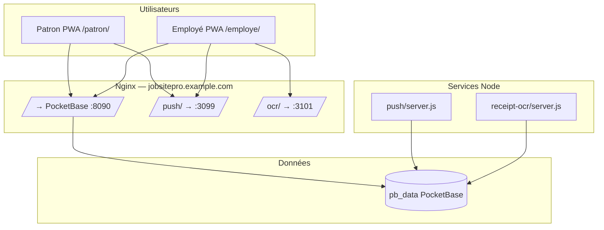

# JobsitePro — Tout est lié (une seule plateforme)

> **JobsitePro** = `patron/` + `employe/` + **PocketBase** + micro-services (`push/`, `receipt-ocr/`).  
> Les dossiers `dext-saas/` et `contractor-saas/` sont des **prototypes séparés** — pas besoin de les lancer pour ton app (image 3).

---

## Schéma global



---

## Chaînes métier (tout passe par PocketBase)

| Flux | Employé | Patron | Base |
|------|---------|--------|------|
| **Dépenses / Dext** | Scan reçu → `/ocr/` → formulaire → `expenses` | Galerie Dext → approuver → facturation / export | `expenses` |
| **Soumissions / Knowify** | — | Phases + taxes Canada → `soumissions` | `soumissions` |
| **Coûts chantier** | Pointage + dépenses approuvées | Dashboard coûts | `sites`, `clock_ins`, `expenses` |
| **Paie** | Bulletins, TD1 | Paie + export .IIF | `payroll_*` + **Wagepoint** (externe) |
| **Alertes** | Notif patron nouvelle dépense | Push admin | `notifications` + `/push/` |

---

## URL unique

Dans patron et employé :

```text
API_URL = https://jobsitepro.example.com
```

- API PocketBase : `https://jobsitepro.example.com/api/...`
- Fichiers reçus : `.../api/files/expenses/{id}/receipt`
- OCR scan : `https://jobsitepro.example.com/ocr/scan-receipt`
- Push : `https://jobsitepro.example.com/push/...`

---

## Déploiement « tout lié » (checklist)

### 1. Front (patron + employé)

```powershell
cd <project-dir>
.\deployment\sync-patron-vers-serveur.ps1 -Server "USER@jobsitepro.example.com"
.\deployment\sync-employe-vers-serveur.ps1 -Server "USER@jobsitepro.example.com"
```

### 2. PocketBase (admin `/_/`)

Champs manuels — voir `pocketbase/PB_SCHEMA_CHANGELOG.md` :

- `expenses` : vendor, tax_amount, notes, ocr_*, PDF sur receipt
- `notifications` : createRule employés + type `expense`
- `soumissions` : collection complète
- `sites` : budgets + lien soumission
- `companies` : tax_province, mileage_rate

### 3. Services serveur

| Service | Port | Test |
|---------|------|------|
| PocketBase | 8090 (local) | `curl -I https://jobsitepro/patron/` |
| Push | 3099 | `curl https://jobsitepro/push/health` |
| OCR reçus | 3101 | `curl https://jobsitepro/ocr/health` (si route ajoutée) |

Installer OCR sur serveur existant :

```bash
cd ~/chantiertrack-v2
sudo bash deployment/install-receipt-ocr.sh
```

### 4. Stack production (prototypes supprimés du repo)

Les dossiers **`receipts-hub/`**, **`platform/`** et **`services/payroll-gateway/`** ont été retirés — toute la logique est dans **patron + employé + PocketBase**.

**QuickBooks (optionnel) :**

```bash
sudo bash deployment/install-integrations-hub.sh   # port 3102
```

Guide complet : **`deployment/DEPLOIEMENT-VPS-JOBSITEPRO.md`** · Carte 5 services : **`docs/ARCHITECTURE-5-SERVICES.md`**

---

## Comptabilité externe (volontairement séparée)

- **QuickBooks / export .IIF** : export fichier depuis JobsitePro (paie / dépenses)
- **Wagepoint** : paie légale **externe** — export Excel heures depuis Patron → Paie

JobsitePro reste la **source opérationnelle** ; la compta officielle reste dans tes outils actuels.

---

*Dernière mise à jour : architecture unifiée JobsitePro.*
